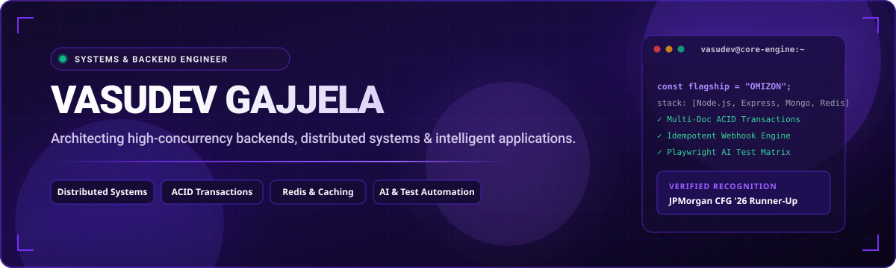
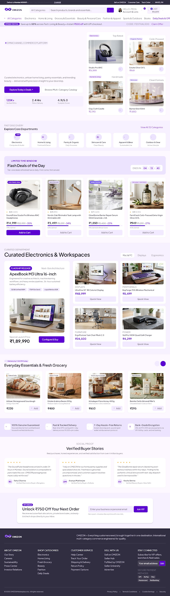
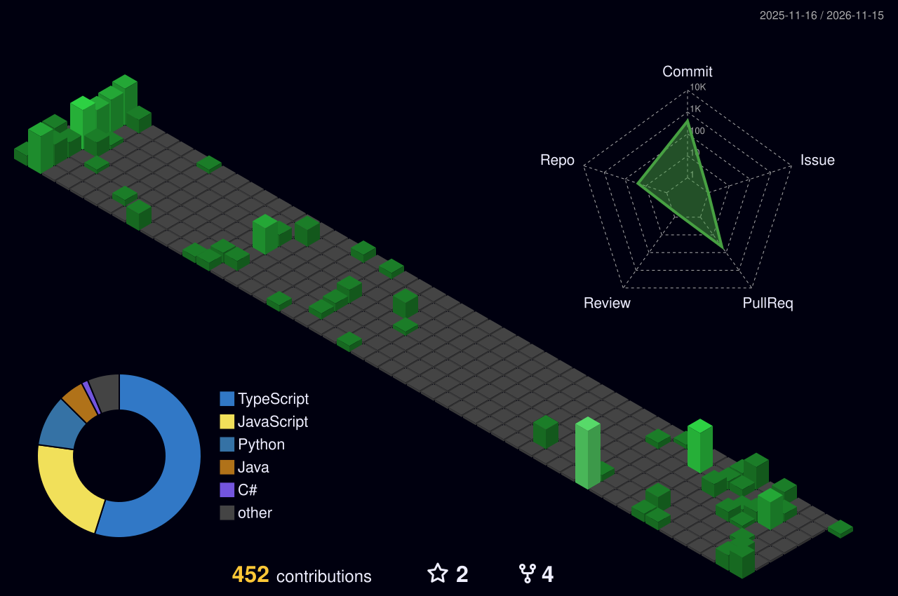

<div align="center">

  <!-- Custom Hero Vector Banner -->
  

  <br/><br/>

  <!-- Quick Action & Connect Badges -->
  <a href="https://linkedin.com/in/gajjelavasudev">
    
  </a>
  &nbsp;
  <a href="mailto:vgajjella@gmail.com">
    
  </a>
  &nbsp;
  <a href="https://github.com/GajjelaVasudev">
    
  </a>
  &nbsp;
  <a href="https://leetcode.com/u/Vasudev_gajjela/">
    
  </a>

  <br/><br/>

  <h3>Software Engineer &bull; Distributed Backend Systems &bull; Applied AI</h3>

  <p align="center">
    <i>Building resilient backend services, practical full-stack platforms, and purposeful AI-driven automation.</i>
  </p>

</div>

---

## ⚡ About Me

I am a **software engineer and Computer Science student** focused on backend systems architecture, high-concurrency web platforms, and practical artificial intelligence.

My engineering approach prioritizes **clarity, resilience, and real-world utility**:
- 🏛 **Systems & Backend Engineering:** Focused on how software operates under real-world concurrency — implementing multi-document ACID transactions in MongoDB, distributed Redis caching, idempotent payment workflows, and structured REST APIs.
- 🤖 **Applied AI & Automation:** Designing practical AI applications and testing systems, including natural language browser automation using Google Gemini and Playwright, and vector-backed retrieval systems with Pinecone.
- 🧩 **First-Principles Problem Solving:** Emphasizing concurrency safety, explicit data validation, predictable failure modes, and clear system boundaries rather than framework hype.

---

## 🎯 Current Focus

- 🚀 **Flagship Engineering:** Hardening **OMIZON**, a full-stack multi-category marketplace featuring multi-document ACID inventory reservations, distributed rate limiting, and webhook idempotency.
- ⚡ **Algorithmic Practice:** Daily problem solving across LeetCode, CodeChef, and Codeforces focusing on data structures, graph algorithms, and dynamic programming.
- 🧠 **Context-Augmented AI:** Building vector-indexed retrieval pipelines (Pinecone) with LLM orchestration for structured, domain-grounded query answering.
- 📦 **DevOps & Testing:** Structuring containerized services with Docker Compose, automated CI verification pipelines, and integration test suites.

---

## 🛠 Technology Stack

A curated toolkit chosen for architectural resilience and practical delivery:

<details open>
<summary><b>View Grouped Capabilities</b></summary>
<br/>

| Domain | Technologies & Frameworks |
| :--- | :--- |
| **Programming Languages** |       |
| **Backend & Systems** |      |
| **Databases & Caching** |     |
| **Frontend Development** |      |
| **AI, Testing & Automation** |     |
| **DevOps & Developer Tools** |      |

</details>

---

## 🌟 Featured Engineering Projects

### 🚀 Tier 1 (Flagship): OMIZON — Scalable Multi-Category Marketplace
> A high-concurrency marketplace backend and design ecosystem engineered to prevent race conditions, overselling, and payment inconsistencies under load.

<p align="center">
  
</p>

```
┌──────────────────────────────────────────────────────────────────────────────────────────┐
│                                OMIZON SYSTEM ARCHITECTURE                                │
│                                                                                          │
│  [ React 19 + Vite Client ] ──► [ Express 5 Gateway / Redis Rate Limiter ]              │
│                                              │                                           │
│                       ┌──────────────────────┴──────────────────────┐                    │
│                       ▼                                             ▼                    │
│        [ Multi-Document ACID Tx ]                       [ Idempotent Webhook Engine ]     │
│        • MongoDB Replica Set                            • Razorpay HMAC-SHA256           │
│        • Atomic Stock Decrement                         • Replay Attack Defense          │
│        • Reservation TTL Expiry                         • Reconciliation Queue           │
└──────────────────────────────────────────────────────────────────────────────────────────┘
```

- **Implementation Status:**
  - **Completed (Backend):** Multi-document MongoDB ACID transactions with replica-set sessions; atomic inventory reservation with TTL expiration; server-side price recalculation (preventing client-side cart tampering); Razorpay Payment Processing with raw-body HMAC SHA-256 signature verification, persistent webhook deduplication keys, and a dedicated reconciliation queue for duplicate charges and failure resolution; Redis distributed rate limiter with in-memory fallback; health/readiness endpoints; integration test suite.
  - **Completed (UI/UX System):** 35+ screen specifications in Stitch (Storefront, PDP, Cart Drawer, Checkout, Account Hub, Seller Hub, Platform Admin, Warehouse Inventory) built on Space Grotesk and Inter typography.
  - **In Progress:** Integrating the React + Vite storefront client with the hardened Express API endpoints.
  - **Planned:** Automated seller payout reconciliation and catalog analytics.
- **Tech Stack:** `Node.js` &bull; `Express 5` &bull; `MongoDB (Replica Sets)` &bull; `Redis` &bull; `Razorpay` &bull; `Docker Compose` &bull; `React + Vite`
- **Explore:** [Repository Overview & Code &rarr;](https://github.com/GajjelaVasudev/scalable-ecommerce-platform) &bull; [Architecture Specifications &rarr;](https://github.com/GajjelaVasudev/scalable-ecommerce-platform#architecture--technology-stack)

---

### 🏆 Tier 2: Core Featured Engineering Systems

<table>
  <tr>
    <td width="50%" valign="top">
      <h3>🤖 Natural Language Test Automation</h3>
      <p><b>AI-Powered Browser Automation Engine</b></p>
      <p>A testing tool that translates plain-English test descriptions into structured executable automation steps via <b>Google Gemini</b> and executes them in real headless browser environments using <b>Playwright</b>.</p>
      <ul>
        <li>Deterministic intent-to-action parsing using JSON schema enforcement.</li>
        <li>Bypasses brittle CSS/XPath selectors by evaluating semantic intent.</li>
        <li>Generates step-by-step execution logs, trace data, and pass/fail assertions.</li>
      </ul>
      <p><b>Tech Stack:</b> <code>JavaScript</code> &bull; <code>Google Gemini API</code> &bull; <code>Playwright</code> &bull; <code>Node.js</code></p>
      <a href="https://github.com/GajjelaVasudev/Natural-Language-Test-Automation"><b>Explore Repository &rarr;</b></a>
    </td>
    <td width="50%" valign="top">
      <h3>📚 NxtGen LMS</h3>
      <p><b>Role-Based Modern Learning Management Platform</b></p>
      <p>A multi-tier platform built to manage course delivery, learning resources, and academic telemetry across multiple stakeholder roles with responsive client interfaces.</p>
      <ul>
        <li>Dedicated workflows and access policies for Admins, Instructors, and Students.</li>
        <li>Relational database schema with 6 SQL migration scripts and audit tables.</li>
        <li>Dynamic assignment submissions and longitudinal learning progress tracking.</li>
      </ul>
      <p><b>Tech Stack:</b> <code>React</code> &bull; <code>TypeScript</code> &bull; <code>Tailwind CSS</code> &bull; <code>Supabase</code> &bull; <code>Express</code></p>
      <a href="https://nxt-gen-lms.vercel.app"><b>🚀 Live Demo</b></a> &bull; <a href="https://github.com/GajjelaVasudev/NxtGen-LMS"><b>Explore Repository &rarr;</b></a>
    </td>
  </tr>
  <tr>
    <td colspan="2" valign="top">
      <h3>🎯 Adaptive Selenium Form Automation</h3>
      <p><b>Context-Aware Resilient Test Suite in C# &bull; .NET 10</b></p>
      <p>An automated form interaction application that navigates dynamic web controls using multi-attribute contextual heuristics rather than brittle, hardcoded DOM selectors.</p>
      <ul>
        <li>Discovers targets by scoring surrounding labels, relative context, and attribute sets.</li>
        <li>Maintains test stability across UI updates, dynamic attribute names, and re-renders.</li>
        <li>Structured console test suite utilizing clean separation of concerns and SOLID design.</li>
      </ul>
      <p><b>Tech Stack:</b> <code>C#</code> &bull; <code>.NET 10</code> &bull; <code>Selenium WebDriver 4.52</code> &bull; <code>Google Chrome</code></p>
      <a href="https://github.com/GajjelaVasudev/Adaptive-Selenium-Automation"><b>Explore Repository &rarr;</b></a>
    </td>
  </tr>
</table>

---

### 🧩 Tier 3: Compact Secondary Engineering Showcases

<div align="center">
  <table>
    <tr>
      <td width="33%" valign="top">
        <h4>🧠 Applied RAG Vector Engine</h4>
        <p>A document retrieval pipeline combining Google GenAI embeddings with a Pinecone vector index and Express 5 API for context-augmented search.</p>
        <p><sub><b>JavaScript &bull; Pinecone &bull; Google GenAI &bull; Express 5</b></sub></p>
        <a href="https://github.com/GajjelaVasudev/rag-project"><b>View Project &rarr;</b></a>
      </td>
      <td width="33%" valign="top">
        <h4>🎫 Webinar Management System</h4>
        <p>Full-stack event platform in Django featuring role-based attendee registration, schedule management, and session recording distribution.</p>
        <p><sub><b>Python 3 &bull; Django &bull; PostgreSQL/SQLite &bull; TypeScript</b></sub></p>
        <a href="https://github.com/GajjelaVasudev/Webinar-Management-System"><b>View Project &rarr;</b></a>
      </td>
      <td width="33%" valign="top">
        <h4>🏛 Student Dashboard Backend</h4>
        <p>Layered Spring Boot microservice implementing controller-service-repository patterns, DTO validation boundaries, and Docker containerization.</p>
        <p><sub><b>Java &bull; Spring Boot &bull; Spring Data JPA &bull; Docker</b></sub></p>
        <a href="https://github.com/GajjelaVasudev/edu-library-backend"><b>View Project &rarr;</b></a>
      </td>
    </tr>
  </table>
</div>

---

## 📊 GitHub Statistics & Telemetry

Activity metrics and consistency tracking across active engineering projects:

<p align="center">
  
  &nbsp;
  
</p>
<p align="center">
  
</p>

---

## 📈 3D Contribution Landscape

An isometric perspective of commit intensity, code reviews, and project velocity across repositories:

<div align="center">
  
  <br/>
  <sub><i>Isometric visualization updated daily at 18:00 UTC via scheduled GitHub Actions (<code>.github/workflows/profile-3d.yml</code>).</i></sub>
</div>

---

## 🏆 Verified Achievements & Credentials

> Every highlight below is backed by primary verifiable evidence, institutional records, and credentials.

<table>
  <tr>
    <td width="50%" valign="top">
      <h4>🥈 JPMorgan Chase Code for Good 2026 — Runner-Up</h4>
      <p><b>Track:</b> Problem Statement 2 (Dharmalife) &bull; <b>Team:</b> Team 28<br/>
      Built <b>DLONE (DLE Sarthi)</b>, an explainable digital assistance platform tailored to rural women micro-entrepreneurs. Engineered hyperlocal recommendation explanations, grounded sales pitch assistance, and multilingual interface with row-level database security.</p>
      <a href="https://lnkd.in/p/dBNVE34r"><b>View Verified LinkedIn Post &rarr;</b></a>
    </td>
    <td width="50%" valign="top">
      <h4>🏛 Smart India Hackathon (SIH) 2024 — Shortlisted</h4>
      <p><b>Role:</b> Backend &amp; Systems Lead &bull; <b>Team:</b> 4 Engineers<br/>
      Proposed and architected a decentralized verification and data processing pipeline for high-volume institutional submission workflows. Implemented decoupled asynchronous ingestion microservices with retry queues and RBAC schemas.</p>
      <a href="https://github.com/GajjelaVasudev"><b>View Repository Context &rarr;</b></a>
    </td>
  </tr>
  <tr>
    <td width="50%" valign="top">
      <h4>☁️ AWS Certified Cloud Practitioner</h4>
      <p><b>Code:</b> CLF-C02 &bull; <b>Issuer:</b> Amazon Web Services<br/>
      Validates foundational cloud architecture principles, security, shared responsibility models, and core AWS services (compute, storage, databases, and networking).</p>
      <a href="https://drive.google.com/file/d/14dmuVTVGn08rc6feKpH3qxN74XwJylIR/view?usp=sharing"><b>Verify Credential PDF &rarr;</b></a>
    </td>
    <td width="50%" valign="top">
      <h4>🤖 GitHub Copilot Certification</h4>
      <p><b>Issuer:</b> Microsoft Learn Credentialing<br/>
      Validates AI-assisted software development competencies, prompt engineering for code synthesis, automated test scaffolding, and refactoring within enterprise developer workflows.</p>
      <a href="https://learn.microsoft.com/api/credentials/share/en-us/VasuGajjela-3547/D4C9EFC6B33D353A?sharingId=83333CF69BBB7554"><b>Verify Microsoft Credential &rarr;</b></a>
    </td>
  </tr>
</table>

---

## 💻 Competitive Programming & Coding Profiles

Algorithmic practice and data structure fundamentals across recognized competitive platforms:

<div align="center">
  <table border="0">
    <tr>
      <td width="55%" align="center" valign="middle">
        <a href="https://leetcode.com/u/Vasudev_gajjela/">
          
        </a>
      </td>
      <td width="45%" align="center" valign="middle">
        <table border="0" width="100%">
          <tr>
            <td align="center">
              <a href="https://leetcode.com/u/Vasudev_gajjela/">
                
              </a>
            </td>
          </tr>
          <tr>
            <td align="center">
              <a href="https://www.codechef.com/users/vkl2400031804">
                
              </a>
            </td>
          </tr>
          <tr>
            <td align="center">
              <a href="https://codeforces.com/profile/Gajjela_Vasudev">
                
              </a>
            </td>
          </tr>
          <tr>
            <td align="center">
              <a href="https://www.hackerrank.com/profile/h2400031804">
                
              </a>
            </td>
          </tr>
        </table>
      </td>
    </tr>
  </table>
</div>

---

## 📬 Let's Connect
My GrowthX code is: 6XQHNS

I am always keen to collaborate on challenging backend systems, distributed architectures, quality engineering pipelines, and open-source software:

<p align="center">
  <a href="https://linkedin.com/in/gajjelavasudev">
    
  </a>
  &nbsp;&bull;&nbsp;
  <a href="mailto:vgajjella@gmail.com">
    
  </a>
  &nbsp;&bull;&nbsp;
  <a href="https://github.com/GajjelaVasudev">
    
  </a>
</p>
